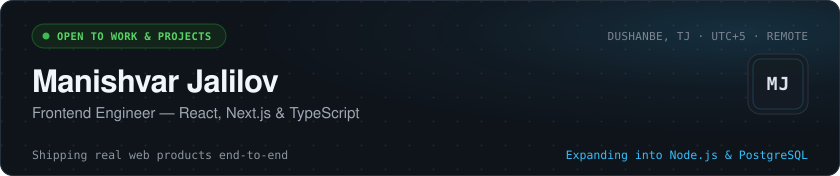
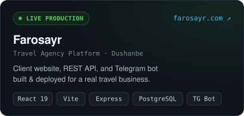
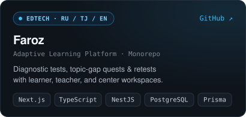

  <picture>
    <source media="(prefers-color-scheme: dark)" srcset="./assets/hero-dark.svg" />
    <source media="(prefers-color-scheme: light)" srcset="./assets/hero-light.svg" />
    
  </picture>

Frontend engineer focused on **React**, **Next.js**, and **TypeScript**. I care about clear architecture, fast interfaces, and shipping real software — from responsive UIs to full product delivery while expanding my backend skills in **Node.js** and **PostgreSQL**.

---

### Selected Work

  <a href="https://farosayr.com">
    <picture>
      <source media="(prefers-color-scheme: dark)" srcset="./assets/card-farosayr-dark.svg" />
      <source media="(prefers-color-scheme: light)" srcset="./assets/card-farosayr-light.svg" />
      
    </picture>
  </a>
  &nbsp;
  <a href="https://github.com/JM-2007-07/Nuvora">
    <picture>
      <source media="(prefers-color-scheme: dark)" srcset="./assets/card-faroz-dark.svg" />
      <source media="(prefers-color-scheme: light)" srcset="./assets/card-faroz-light.svg" />
      
    </picture>
  </a>

- **Farosayr** — [farosayr.com ↗](https://farosayr.com) · [Source code](https://github.com/JM-2007-07/Farosayr---Travel-Agency) — Production website, REST API, and Telegram bot for a travel agency in Dushanbe.
- **Faroz** — [Source code](https://github.com/JM-2007-07/Nuvora) — Multilingual EdTech platform (RU / TJ / EN) with diagnostic gap analysis, quests, and learner/teacher/center workspaces.

---

### Stack

| Area | Technologies |
| :--- | :--- |
| **Frontend** | `TypeScript` · `React 19` · `Next.js` · `Tailwind CSS` · `Redux Toolkit` · `Zustand` · `TanStack Query` · `Vite` |
| **Backend (Growing)** | `Node.js` · `Express` · `NestJS` · `PostgreSQL` · `Prisma` · `REST / Swagger` · `Telegram Bot API` |
| **UI & Tooling** | `shadcn/ui` · `MUI` · `i18n (next-intl / i18next)` · `pnpm workspaces` · `Git` · `Vercel` |

---

**Contact:** [Telegram](https://t.me/JM_2007_07) · [manishvarjalilov@gmail.com](mailto:manishvarjalilov@gmail.com) · [X (@AsilJM)](https://x.com/AsilJM) &nbsp;·&nbsp; `Dushanbe, Tajikistan · Remote`
